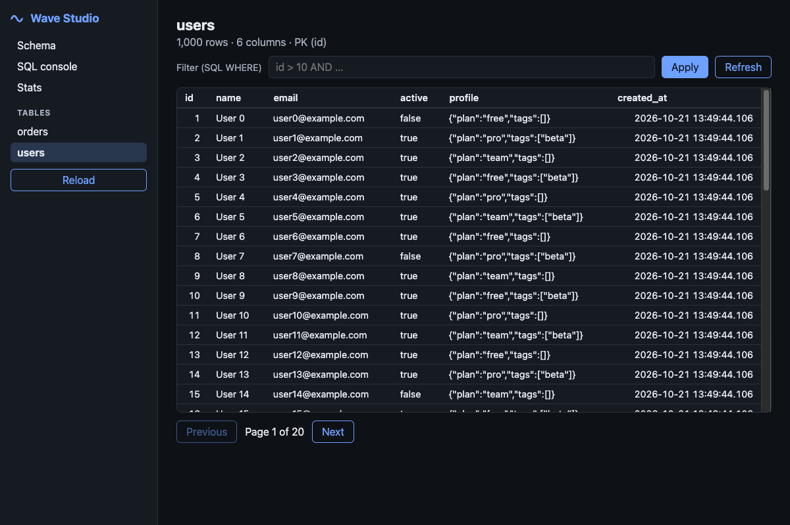

# WaveDB

**A concurrent-write embedded relational database for TypeScript** — one Rust core, usable from Node and Bun.

```bash
npm install @purplemon/wavedb    # or: bun add @purplemon/wavedb / pnpm add @purplemon/wavedb
```

Node ≥ 20 or Bun ≥ 1.1. Prebuilt native addons ship per platform; from this repo, run `bun run build:native` (Rust). [Deployment guide](docs/deployment.md).

- **Many writers, no global write lock.** MVCC snapshots + optimistic concurrency control (OCC): transactions that touch
  different keys never block or conflict; conflicting ones are detected at commit and retried automatically by `db.tx()`.
- **Real transactions.** Snapshot isolation by default, `serializable` on request (read-key and range/phantom validation).
- **Relational, typed, ergonomic.** Schema-as-code DSL, a typed query builder (Drizzle-style), a `sql` tagged template,
  a relational `db.query.users.findMany({ with: { posts: true } })` API, secondary / unique / composite indexes, joins,
  aggregates, `RETURNING`, upserts, additive schema migrations.
- **Durable by default.** Crash-safe (fjall LSM journal, `kill -9` tested) with group-commit `fsync`.
- **Studio.** `wave studio` serves a web UI (table browser, SQL console, schema, stats).
- **Multi-process.** `wave serve` / `serve(db)` exposes the same API over HTTP; `connect(url)` is a drop-in `Database`.

```ts
import { wave, table, int, text, timestamp, eq, desc, sql } from "@purplemon/wavedb";

const users = table("users", {
  id: int().autoIncrement(),
  email: text().notNull().unique(),
  name: text().notNull(),
  createdAt: timestamp("created_at").notNull().defaultNow(),
});
const posts = table("posts", {
  id: int().autoIncrement(),
  authorId: int("author_id").notNull().references(() => users.id).index(),
  title: text().notNull(),
});

const db = await wave("./data.wave", { schema: { users, posts } }); // creates / migrates tables

await db.insert(users).values({ email: "ada@example.com", name: "Ada" });

// transactions retry on conflict automatically
await db.tx(async (tx) => {
  const [ada] = await tx.select().from(users).where(eq(users.email, "ada@example.com"));
  await tx.insert(posts).values({ authorId: ada!.id, title: "Hello, wave" });
});

const rows = await db.select().from(users).innerJoin(posts, eq(posts.authorId, users.id)).orderBy(desc(posts.id));
//    ^? { users: {...}, posts: {...} }[]

const withPosts = await db.query.users.findMany({ where: { name: { like: "A%" } }, with: { posts: true } });
const n = await db.sql<{ n: number }>`SELECT count(*) AS n FROM posts WHERE author_id = ${1}`;
```

## Status

WaveDB is **early software** (0.1). The engine is well tested, but the on-disk format may still change before 1.0.

### Implemented

| Area | What works |
|---|---|
| **Storage / MVCC** (`crates/wave-core`) | Versioned keys on the [fjall](https://github.com/fjall-rs/fjall) LSM (no hand-written LSM), snapshot reads with a single seek, tombstones, vacuum of versions no snapshot can see, dead-version skipping for hot rows, shared engine registry per path, crash recovery. |
| **Concurrency** | Optimistic commits validated against recent writes (first-committer-wins) with a short commit mutex; `snapshot` and `serializable` isolation (point + range/phantom validation); group-commit `fsync` (leader election + commit window); conflict-free auto-increment ids; unique-index guard keys so concurrent duplicate inserts conflict instead of both succeeding. |
| **Relational layer** | Catalog, typed columns (`int real text bool blob json timestamp uuid`), PK (single/composite), unique + secondary + composite indexes (backfilled on creation), defaults (`now()`, uuid v4/v7, constants), NOT NULL, column ids so ADD / DROP / RENAME COLUMN are metadata-only. |
| **Queries** | Planner (PK / index equality, `IN`, ranges, ordered scans with early `LIMIT`, reverse for `DESC`), nested-loop joins with index lookups, hash aggregation (`count sum avg min max`, `DISTINCT`, `GROUP BY`, `HAVING`), `EXPLAIN`, `RETURNING`, `ON CONFLICT DO NOTHING / DO UPDATE` (with `excluded.*`). |
| **SQL** | A parser front-end (sqlparser) onto the same statement IR the builder emits: `SELECT` (joins, group, having, order, limit/offset, distinct), `INSERT`, `UPDATE`, `DELETE`, `CREATE/DROP TABLE|INDEX`, `ALTER TABLE` (one op), `EXPLAIN`, `$n` / `?` params. |
| **Bindings** | napi-rs addon (async tasks on the thread pool + sync variants); the same `.node` loads in Node ≥ 20 and Bun. |
| **TypeScript package** (`packages/wavedb`) | Schema DSL, typed builders, `sql` tag, `db.tx()` with retry/back-off and `snapshot`/`serializable`, manual `begin()`, relational `db.query`, `diff()` / `push()` (additive; destructive changes need `allowDestructive`), ordered `migrate()` runner, `watch()`, `vacuum()`/`compact()`/`stats()`, typed errors (`ConflictError`, `ConstraintError`, …). |
| **Server / remote** | `serve(db, { token, staticDir })` (Node `http`, Bun compatible) with remote transactions (idle rollback), bearer token auth; `connect(url)` returns the same `Database` API over HTTP. |
| **CLI** (`packages/wave-cli`) | `wave studio`, `dev`, `serve`, `sql` (one-shot + REPL), `tables`, `stats`, `diff`, `push`, `export`, `import`, `vacuum`, `compact`. |
| **Studio** (`packages/wave-studio`) | Vite + React SPA: table browser (filter, sort, paging), SQL console with history, schema view, live engine stats. Lighthouse accessibility 100 / best-practices 100. |

### Deferred / known gaps

- **Single process owns the files.** fjall holds a directory lock, so a second process cannot open the same `data.wave`; use `wave serve` + `connect()`. Optional leader lease + `connect({ urls })` failover — see [deployment](docs/deployment.md).
- **SQL subset:** no triggers; correlated subqueries not supported. Identifiers are case-sensitive. Prefer `db.tx()` over ad-hoc SQL sessions for app code.
- **Replication / sharding / encryption at rest** are out of scope for 0.1.

## Quick start (monorepo / from source)

Requirements: Rust (stable) for the native addon, and [Bun](https://bun.sh) ≥ 1.1 or Node ≥ 20.

```bash
bun install
bun run build:native            # cargo build --release + copy to packages/wavedb/native/
bun run test                    # Rust + TypeScript + Node smoke test

bun tools/seed-demo.ts ./demo.wave        # 1k users + 20k orders
(cd packages/wave-studio && bunx vite build)
bun packages/wave-cli/src/main.ts studio ./demo.wave   # → http://127.0.0.1:4400
```



### CLI

```text
wave studio [path]    web UI              --port 4400 --open --token T
wave serve  [path]    HTTP API            --port 4401 --host 127.0.0.1 --token T
wave sql [path] [SQL] one-shot / REPL     --json
wave tables | stats | vacuum | compact [path]
wave diff | push [path] --schema ./schema.ts [--force]
wave export [path] --out dump.json   /   wave import [path] --in dump.json
```

### Multi-process

```ts
import { wave, serve, connect } from "@purplemon/wavedb";
const db = await wave("./data.wave", { schema });
const server = await serve(db, { port: 4401, token: "secret" });   // host process

const remote = await connect("http://127.0.0.1:4401", { schema, token: "secret" });  // any other process
await remote.tx(async (tx) => { /* identical API, conflicts retried over the wire */ });
```

## How it works

```
 TypeScript API ── JSON statement IR ──▶ N-API ──▶ wave-core
 (builders, sql tag, tx retry)                       ├─ exec / planner / SQL parser
                                                     ├─ catalog + row codec + indexes
                                                     └─ kv: MVCC + OCC over fjall (LSM)
```

- **Keys.** A user key is stored as `escape(k) ‖ 00 00 ‖ BE(!commit_ts)` so versions of a key sort newest-first; a snapshot read at `ts`
  is one seek. The first byte of the value tags it as value / tombstone.
- **Commit.** Under a short mutex the transaction's write set is validated against an in-memory map of recent commits
  (pruned at the oldest active snapshot); on success the batch is appended with the next commit timestamp. Durability
  (`sync`, default) waits for a group `fsync` outside the mutex.
- **Relational layout** (keys inside the same MVCC space): `01 name` catalog, `10 table pk` rows, `20 index cols pk` index
  entries, `21 index cols` unique guards. Rows are `[column id][tag][payload]`, so schema evolution is metadata-only.
- **Statement IR.** The SQL parser and the TypeScript builder both produce the same serde JSON IR, so there is a single
  executor and a single planner.

## Testing

```bash
bun run test        # = cargo test --workspace  &&  build native + bun test  &&  node scripts/node-smoke.mjs
```

- **Rust** (`cargo test --workspace`): MVCC/OCC (conflicts, snapshot isolation, write skew, phantoms, group commit, vacuum,
  hot-key scans, recovery after reopen/compaction) and the relational/SQL layer (planner, indexes, constraints, upserts,
  joins, aggregates, schema evolution, a randomized model test).
- **TypeScript** (`bun test`): typed builders and transactions against the real native addon; concurrent read-modify-write
  without lost updates; **small and large databases** (100k-row load, indexed/range/aggregate/join queries verified against
  closed-form results, 20k updates of one hot row, 8 concurrent disjoint writers with 0 conflicts); schema push/migrations;
  HTTP server / remote clients (auth, idle transaction rollback); **crash recovery** (a child process is `SIGKILL`ed
  mid-write twice: every acknowledged commit survives and multi-table commits stay atomic); CLI.
- **Node:** `scripts/node-smoke.mjs` builds `dist/` and runs the package under plain Node.
- **Studio** was exercised in a real browser (navigation, filtering, sorting, SQL errors, stats) and audited with Lighthouse.

## Benchmarks

`bun run bench` (add `--quick` for a short pass). WaveDB only — no comparisons. Everything goes through the public
TypeScript API (builders → JSON → N-API → Rust) on a fresh temporary database; 64-byte string values; `async` durability
unless noted. Latency is per operation as seen by the caller.

> **Disclaimer:** these numbers are from one machine and one run — **Apple M4 (10 cores), 16 GiB, macOS (darwin-arm64), Bun 1.4.1,
> 2026-10-21**. Throughput depends on CPU, disk, runtime and thread-pool size, and the load generator itself is a single JS
> thread, so concurrent figures are a *lower bound* for the engine. Re-run on your hardware before drawing conclusions.
> Raw output: [`tools/bench/results.json`](tools/bench/results.json).

| Scenario | Workers | Durability | ops/sec | p50 | p99 |
|---|---:|---|---:|---:|---:|
| write: disjoint keys (1 row/commit) | 1 | async | 50,235 | 0.018 ms | 0.063 ms |
| write: disjoint keys (1 row/commit) | 4 | async | 99,700 | 0.031 ms | 0.15 ms |
| write: disjoint keys (1 row/commit) | 16 | async | 119,827 | 0.104 ms | 0.558 ms |
| write: disjoint keys (1 row/commit) | 32 | async | 115,590 | 0.199 ms | 1.189 ms |
| write: disjoint keys (1 row/commit) | 1 | **sync** (fsync) | 276 | 3.909 ms | 4.994 ms |
| write: disjoint keys (1 row/commit) | 8 | **sync** | 2,094 | 3.927 ms | 6.97 ms |
| write: disjoint keys (1 row/commit) | 32 | **sync** | 2,606 | 11.01 ms | 33.044 ms |
| write: batched insert (1000 rows/tx) | 1 | async | 245,725 rows/s | – | – |
| read: point lookup by PK (100k rows) | 1 | async | 54,818 | 0.017 ms | 0.027 ms |
| read: point lookup by PK | 8 | async | 180,219 | 0.043 ms | 0.099 ms |
| read: point lookup by PK | 32 | async | 300,598 | 0.083 ms | 0.353 ms |
| read: secondary-index lookup (~100 rows) | 8 | async | 12,299 | 0.638 ms | 1.018 ms |
| read: range scan (100 rows by PK) | 8 | async | 35,476 | 0.204 ms | 0.511 ms |
| mixed: 90% read / 10% write | 8 | async | 217,180 | 0.035 ms | 0.092 ms |
| mixed: 90% read / 10% write | 32 | async | 299,686 | 0.084 ms | 0.361 ms |
| mixed: 50% read / 50% write | 8 | async | 177,531 | 0.034 ms | 0.181 ms |
| mixed: 50% read / 50% write | 32 | async | 200,549 | 0.122 ms | 0.631 ms |
| write: update disjoint existing rows | 8 | async | 135,158 | 0.048 ms | 0.21 ms |
| contended: read-modify-write tx on 1 row (auto-retry) | 16 | async | 17,884 | 0.044 ms | 1.198 ms |
| contended: atomic `UPDATE n = n + 1` on 1 row | 16 | async | 87,385 | 0.038 ms | 3.95 ms |

What the numbers show:

- **Disjoint writers scale and never conflict** (the benchmark asserts `conflicts == 0`): 50k → ~120k commits/s as concurrency rises,
  until the single-threaded JS driver saturates.
- **Durable (`sync`) commits are bounded by `fsync` latency (~4 ms on this laptop's SSD).** One writer gets ~276 commits/s;
  group commit lets concurrent writers share an `fsync` (8+ commits per fsync), reaching ~2.6k commits/s.
- **Hot-row contention is correct, not free:** 16 workers incrementing one row finish with the exact total (the benchmark checks for
  lost updates) after 362 automatic conflict retries in 15,000 transactions.

## Repository layout

```
crates/wave-core     Rust engine: kv (MVCC/OCC on fjall), catalog, planner/executor, SQL front-end
crates/wave-napi     N-API bindings (JSON string boundary)
packages/wavedb      TypeScript API, HTTP server + remote client, tests
packages/wave-cli    `wave` command
packages/wave-studio Vite + React web UI
tools/bench          benchmarks;  tools/seed-demo.ts  demo data
scripts/             build-native.mjs, node-smoke.mjs
```

## License

MIT
